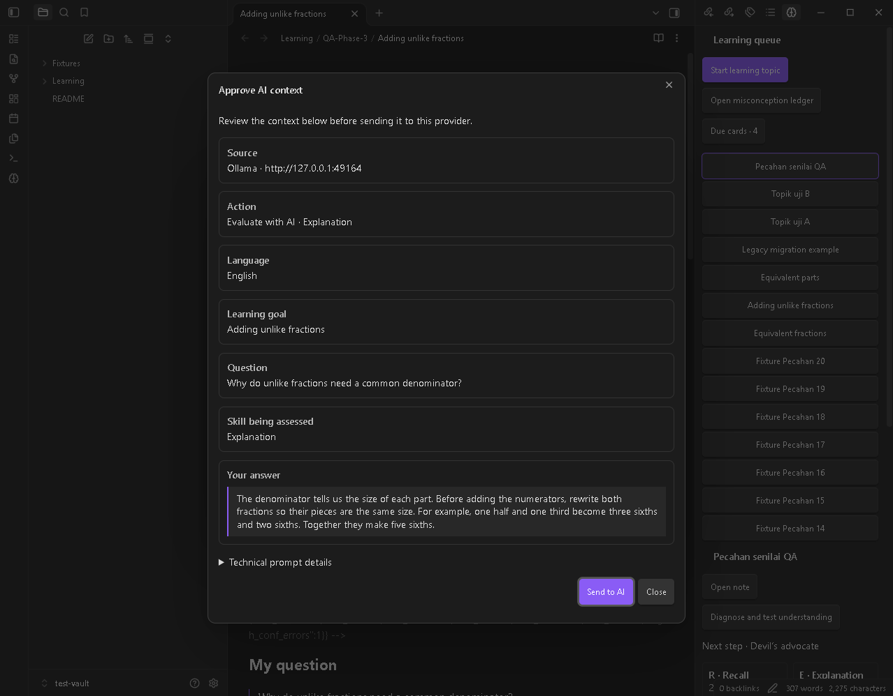
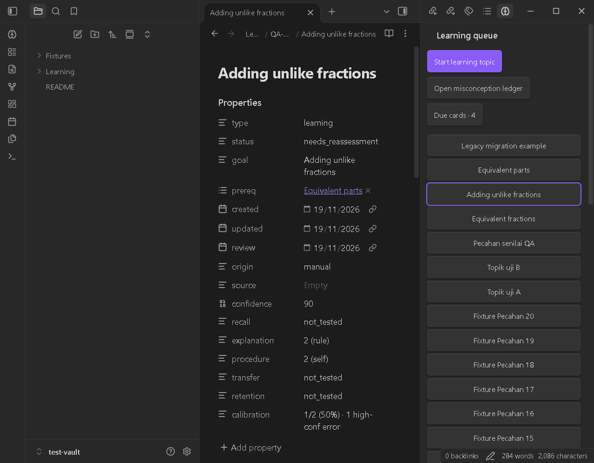

# Curiosity Learning

[English](README.md) · **Bahasa Indonesia** · [Obsidian Community Plugins](https://community.obsidian.md/plugins/curiosity-learning) · [GitHub Releases](https://github.com/Finarfin12/curiosity-learning/releases) · [Curiosity Capture (Ekstensi Chrome)](https://github.com/Finarfin12/curiosity-capture) · [Curiosity Skill (Skill Agent)](https://github.com/Finarfin12/curiosity-skill)

Plugin Obsidian untuk mencatat dugaan awal, menguji pemahaman, dan mengulang materi. Memerlukan Obsidian 1.8.0 atau lebih baru. Tersedia dalam Bahasa Indonesia dan Inggris.

## Instalasi

- **Dari Obsidian Community Plugins (disarankan):** Buka [https://community.obsidian.md/plugins/curiosity-learning](https://community.obsidian.md/plugins/curiosity-learning) atau masuk ke **Settings → Community plugins → Browse**, cari **Curiosity Learning**, klik **Install**, lalu **Enable**.
- **Dari GitHub Releases:** Unduh `main.js`, `manifest.json`, dan `styles.css` dari [rilis terbaru](https://github.com/Finarfin12/curiosity-learning/releases) ke `<vault>/.obsidian/plugins/curiosity-learning/`, lalu aktifkan di **Settings → Community plugins**.
- **Build lokal:** Jalankan `npm ci` dan `npm run build`. Salin `main.js`, `manifest.json`, dan `styles.css` ke `.obsidian/plugins/curiosity-learning/` di vault tujuan. Untuk mencoba fixture, jalankan `npm run install-test-vault` dan buka folder `test-vault` sebagai vault.

## Belajar dan mengulang

1. Jalankan **Curiosity Learning: Mulai topik belajar**. Isi tujuan, pertanyaan, dugaan awal, lalu pilih keyakinan 50%, 70%, atau 90%. Folder bawaan `Learning/Topics` dan `Learning/Inbox` dapat diubah di Settings.
2. Buka **Diagnosis dan uji pemahaman**. Pada tab **Ajari**, simpan uraian dari sumber belajar atau contoh lengkap. Gunakan **Feynman** untuk umpan balik berbasis aturan dan **Socratic** untuk satu pertanyaan per giliran. Gunakan petunjuk, jelaskan sekarang, lewati, atau berhenti sesuai kebutuhan.
3. Pada **Uji lagi**, bandingkan dugaan awal dan jawaban baru. Nilai jawaban secara mandiri. Jawaban akhir yang benar membuat kartu ingat ulang. Jawaban salah dengan keyakinan 90% masuk ke buku salah paham.
   Di **Ajari**, simpan satu langkah per baris dan soal mandiri terpisah. Pilih tingkat untuk menyembunyikan langkah terakhir atau melihat soal baru saja. **Uji bantahan** selalu bisa dibuka manual dan direkomendasikan setelah skor penjelasan mencapai 2 dan prosedur sudah diuji.
4. Buka **Antrean belajar** untuk melihat lima skor dan sumber buktinya. Buka **Ulas kartu jatuh tempo (FSRS)**, pilih keyakinan, lalu balik kartu. **Ulangi** mengembalikan kartu ke antrean sesi yang sama sampai dinilai **Baik** atau **Mudah**. Ulasan hari yang sama memperbarui skor ingat ulang. Ulasan setelah jeda hari memperbarui retensi tertunda. Aktifkan **Acak antartopik** untuk mencampur kartu dari beberapa topik dalam satu sesi.
5. Buka **Buku salah paham** untuk menulis koreksi.

Skor menunjukkan jenis tugas yang sudah diuji dan cara penilaiannya. Peta keyakinan membandingkan keyakinan dengan akurasi mandiri. Kartu memakai FSRS-5 internal dengan interval satu hari setelah berhasil mengulang kartu yang gagal. [Model FSRS-5](https://open-spaced-repetition.github.io/ts-fsrs/guide/model/fsrs-5)

## Markdown

Markdown adalah sumber data utama. Catatan baru memakai `type: learning`, properti datar, dan komentar Markdown tersembunyi untuk ID, skema, tanggal skor, serta rincian kalibrasi. Ubah nama bawaan catatan baru di **Settings → Nama properti**. Jalankan **Migrasikan properti** pada catatan belajar untuk memakai nama terbaru, termasuk dari format lama `cl_*`. Properti tambahan dan teks bebas dipertahankan. Bentrok nama menghentikan migrasi. Agen eksternal dapat mengikuti [kontrak vault](skills-src/curiosity-skill/SKILL.md).

### Templat

Saat pertama kali aktif, Curiosity Learning menawarkan pembuatan dua file templat siap pakai (`Curiosity Learning Topic.md` dan `Curiosity Learning Inbox.md`) di **Folder templat** yang dikonfigurasi (otomatis mengikuti folder plugin inti Templates Obsidian atau `Templates`). Kamu juga bisa membuatnya kapan saja lewat **Settings → Templat → Buat templat** atau perintah **Buat templat**. File yang sudah ada tidak pernah ditimpa, file templat dikecualikan dari Antrean belajar, dan catatan baru yang dibuat dari templat tersebut akan otomatis diinisialisasi dengan ID unik dan metadata tanggal.

## Prasyarat dan tangkapan browser

- Isi satu judul atau wikilink per baris saat membuat topik atau melalui **Edit prasyarat** di diagnosis. Antrean menampilkan prasyarat yang sudah teruji, belum teruji, hilang, atau ambigu.
- Pasang ekstensi Curiosity Capture dari paket lokal. Blok teks halaman dan gunakan ikon, pintasan, atau menu klik kanan. Tinjau kolom dan kirim. Konfirmasi di Obsidian untuk membuat satu catatan baru di inbox. Folder bawaan adalah `Learning/Inbox`.
- Untuk tangkapan panjang atau jika tautan aplikasi tidak terbuka, gunakan **Salin Markdown** dan jalankan **Impor Markdown tangkapan** di Obsidian. Keduanya menggunakan ID tangkapan yang sama. Plugin mengingat 200 ID terakhir yang disimpan.

## Pengungkapan jaringan

Curiosity Learning 0.4.2 bekerja offline secara bawaan. Aktifkan **Pencarian sumber online** saat diperlukan. Di **Cari sumber kredibel**, pilih penyedia, periksa kata kunci, dan tekan **Setujui & cari kata kunci ini**. Penyedia menerima kata kunci yang disetujui. Isi catatan tetap di vault. Permintaan kedua PubMed hanya berisi ID hasil pencarian. Pengecekan DOI manual mengirim DOI ke Crossref. Pengecekan URL manual mengirim judul yang diisi ke Crossref atau Wikipedia sesuai bahasa URL, lalu mencocokkan URL dengan metadata hasil.

| Penyedia | Tujuan | Data opsional |
| --- | --- | --- |
| Crossref | `api.crossref.org/works` | Email kontak melalui `mailto` |
| OpenAlex | `api.openalex.org/works` | API key melalui `api_key` |
| PubMed | `eutils.ncbi.nlm.nih.gov/entrez/eutils/` | — |
| Semantic Scholar | `api.semanticscholar.org/graph/v1/paper/search` | API key melalui `x-api-key` |
| Wikipedia | `id.wikipedia.org/w/rest.php/v1/search/page` atau `en.wikipedia.org/w/rest.php/v1/search/page` | — |

Kunci disamarkan di Settings dan disimpan di konfigurasi plugin lokal dalam vault. Verifikasi mengecek identitas DOI atau URL. Tingkat bukti diperkirakan dari metadata dan tidak menilai kualitas penelitian. **Simpan sebagai belum terverifikasi** bisa dipakai offline. Buka tab **Bukti** untuk melihat sumber yang tersimpan di topik.

## AI opsional

Buka **Settings → Curiosity Learning → AI opsional**. Pilih **CLI lokal**, **HTTP lokal**, atau **API cloud**, lalu tentukan penyedia dan pilih model dari dropdown **Nama model** (terdeteksi otomatis untuk tiap penyedia). Mode **Nonaktif** tetap menyediakan seluruh alat manual. **Deteksi penyedia lokal** memeriksa CLI di desktop dan layanan HTTP loopback sekaligus menyegarkan daftar model di dropdown setelah tombol ditekan.

| Mode | Pengaturan |
| --- | --- |
| CLI desktop | Claude Code, Codex CLI, Gemini CLI, atau Ollama melalui PATH. Windows memerlukan executable native. Gemini CLI memakai folder terisolasi dan autentikasi API dari environment. Ollama CLI mendeteksi model terpasang pada layanan loopback. |
| HTTP lokal | Ollama di `http://127.0.0.1:11434` atau LM Studio di `http://127.0.0.1:1234`, atau port loopback lain. Otomatis memuat model yang terpasang ke dropdown. |
| API cloud | OpenAI-compatible, Anthropic, atau Gemini. Isi kunci API dan pilih model bawaan atau model dari endpoint pada dropdown. OpenAI-compatible menerima alamat dasar API HTTPS yang kamu percayai. |

Dalam **Diagnosis dan uji pemahaman**, AI dapat mengusulkan contoh tiga langkah, satu pertanyaan diagnosis, soal uji lagi yang setara, atau penilaian atas kemampuan yang diuji. Periksa penyedia, aksi, dan konteks sebelum setiap pengiriman. Tinjau hasilnya sebelum menerapkan. Penilaian yang diterima dicatat sebagai `observed_ai` dan tampil seperti `2 (ai)` di Properties. Penjelasan AI dapat merujuk pada nomor sumber yang sudah disimpan lewat **Cari sumber kredibel**. Jika provider gagal, lanjutkan dengan alur manual.

### Pengungkapan jaringan AI

AI nonaktif secara bawaan. Plugin hanya mengirim konteks yang disetujui beserta instruksi tetap ke penyedia yang dipilih. HTTP lokal memakai alamat loopback. CLI menerima prompt lewat stdin dan bisa terhubung ke layanan penyedianya, termasuk cloud untuk Claude Code, Codex, dan Gemini. API cloud menghubungi `api.openai.com` atau host HTTPS kompatibel yang dipilih, `api.anthropic.com`, atau `generativelanguage.googleapis.com`. Penyedia dapat mengenakan biaya pemakaian cloud.

Kunci API dipisahkan menurut penyedia dan endpoint. Plugin memakai penyimpanan rahasia Obsidian pada versi yang mendukungnya dan memori sesi untuk versi lama. Kunci dikecualikan dari catatan belajar dan pratinjau persetujuan. Plugin menulis hasil belajar setelah kamu menyetujuinya.

## Screenshot

- [Antrean belajar dan properti datar](docs/images/learning-queue.png)
- [Peta keyakinan dan prasyarat](docs/images/confidence-map.png)
- [Mulai topik belajar dan dugaan awal](docs/images/pretest.png)
- [Contoh lengkap](docs/images/worked-example.png)
- [Contoh dengan langkah terakhir dikosongkan](docs/images/fading.png)
- [Diagnosis Feynman](docs/images/feynman.png)
- [Diagnosis Socratic](docs/images/socratic.png)
- [Uji Bantahan](docs/images/devils-advocate.png)
- [Cari sumber kredibel](docs/images/find-sources.png)
- [Bukti tersimpan](docs/images/evidence.png)
- [Ulasan FSRS](docs/images/fsrs-review.png)
- [Buku salah paham](docs/images/misconception-ledger.png)
- [Konfirmasi tangkapan browser](docs/images/capture-confirmation.png)
- [Ekstensi Curiosity Capture](docs/images/curiosity-capture.png)
- [Persetujuan AI](docs/images/optional-ai.png)
- [Hasil penilaian AI](docs/images/ai-result.png)

## Pengembangan

Jalankan `npm test`, `npm run lint`, dan `npm run build`. Lihat [vault uji](test-vault/README.md) untuk skenario manual. MIT © 2026 Finarfin12.
