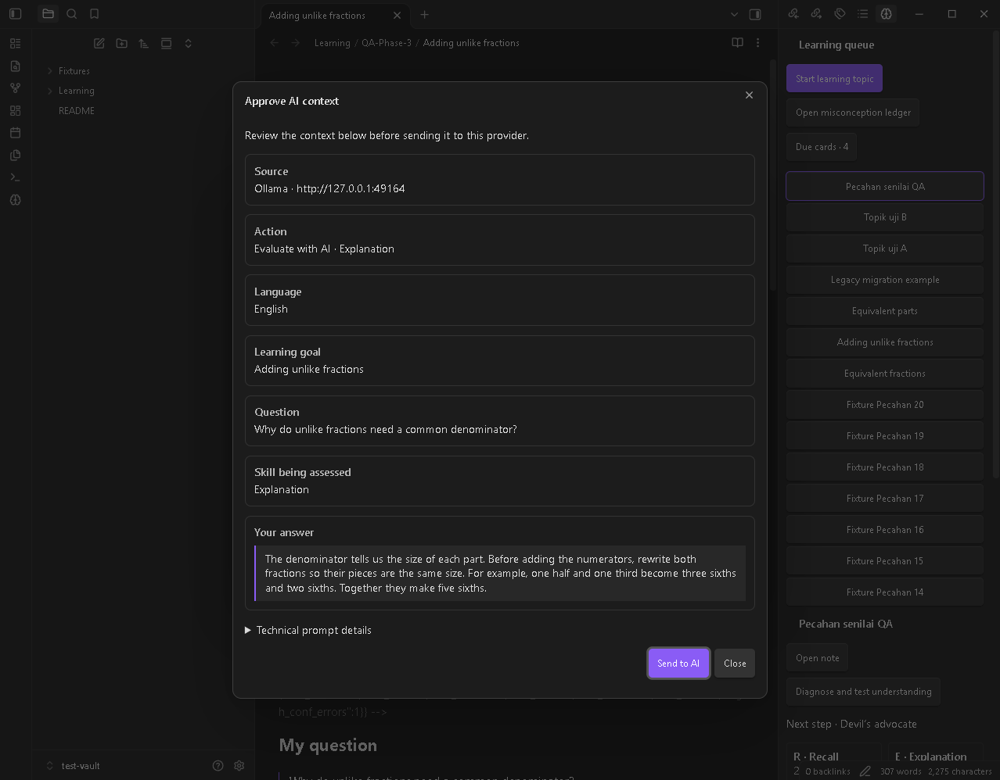
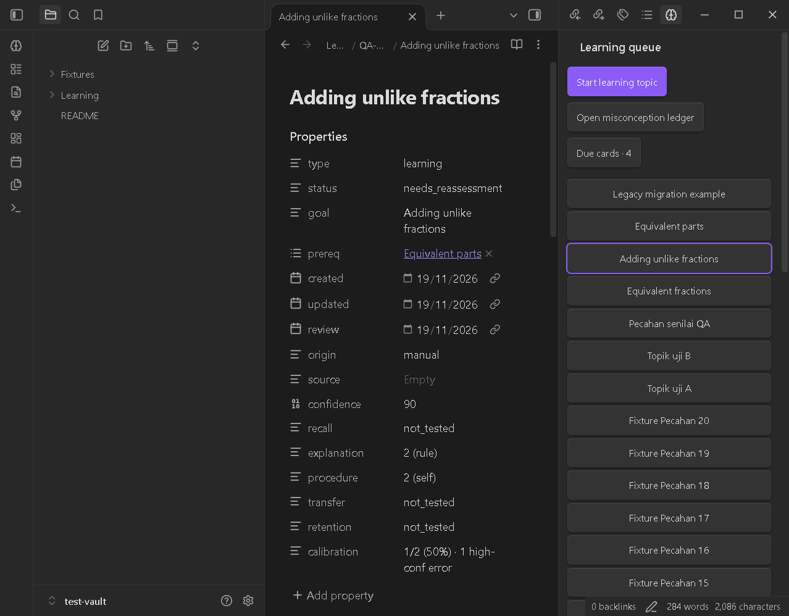

# Curiosity Learning

**English** · [Bahasa Indonesia](README.id.md) · [Obsidian Community Plugins](https://community.obsidian.md/plugins/curiosity-learning) · [GitHub Releases](https://github.com/Finarfin12/curiosity-learning/releases) · [Curiosity Capture (Chrome Extension)](https://github.com/Finarfin12/curiosity-capture) · [Curiosity Skill (Agent Skill)](https://github.com/Finarfin12/curiosity-skill)

An Obsidian plugin for capturing a first guess, testing understanding, and reviewing what you learn. Requires Obsidian 1.8.0 or later. Includes English and Indonesian.

## Install

- **From Obsidian Community Plugins (recommended):** Open [https://community.obsidian.md/plugins/curiosity-learning](https://community.obsidian.md/plugins/curiosity-learning) or go to **Settings → Community plugins → Browse**, search for **Curiosity Learning**, click **Install**, and then **Enable**.
- **From GitHub Releases:** Download `main.js`, `manifest.json`, and `styles.css` from the [latest release](https://github.com/Finarfin12/curiosity-learning/releases) into `<vault>/.obsidian/plugins/curiosity-learning/` and enable the plugin in **Settings → Community plugins**.
- **Build locally:** Run `npm ci` and `npm run build`. Copy `main.js`, `manifest.json`, and `styles.css` into `.obsidian/plugins/curiosity-learning/` inside the target vault. To try the included fixtures, run `npm run install-test-vault` and open `test-vault` as a vault.

## Learn and review

1. Run **Curiosity Learning: Start learning topic**. Enter the goal, question, first guess, and confidence at 50%, 70%, or 90%. The default folders are `Learning/Topics` and `Learning/Inbox`. Change them in Settings.
2. Open **Diagnose and test understanding**. In **Teach**, add your own source explanation or worked example. Use **Feynman** for rule-based feedback and **Socratic** for one diagnostic question at a time. Use the hint, explain, skip, or stop controls as needed.
3. In **Post-test**, compare your first guess and new answer. Assess the answers yourself. A correct post-test adds a recall card. An incorrect answer at 90% confidence goes to the misconception ledger.
   In **Teach**, save one step per line and a separate independent problem. Use the level selector to hide the final step or show only the new problem. **Devil’s advocate** is available on demand and recommended after the explanation score reaches 2 and procedure has been assessed.
4. Open the **Learning queue** to see the five scores and the evidence source. Open **Review due cards (FSRS)**, choose confidence, and reveal the answer. **Again** returns the card to the same session until **Good** or **Easy**. Same-day attempts update recall and delayed attempts update retention. Turn on **Interleave topics** within a session to mix cards across topics.
5. Open the **misconception ledger** to record corrections.

Scores indicate which tasks were tested and how each was evaluated. The confidence map compares confidence and self-rated accuracy. Cards use an internal FSRS-5 model with a one-day interval after relearning. [FSRS-5 model](https://open-spaced-repetition.github.io/ts-fsrs/guide/model/fsrs-5)

## Markdown

Markdown is the source of truth. New notes use `type: learning`, flat properties, and a hidden Markdown comment for ID, schema, score dates, and detailed calibration. **Settings → Property names** changes the defaults for new notes. Run **Migrate properties** on a learning note to apply the current names, including conversion from legacy `cl_*` properties. Existing custom properties and prose are retained, and conflicting names prevent migration. External agents can follow the [vault contract](skills-src/curiosity-skill/SKILL.md).

### Templates

On first startup, Curiosity Learning offers to create two ready-to-use templates (`Curiosity Learning Topic.md` and `Curiosity Learning Inbox.md`) inside your configured **Templates folder** (falling back to Obsidian’s core Templates folder or `Templates`). You can also generate them any time from **Settings → Templates → Create templates** or the **Create templates** command. Existing files are never overwritten, template files are excluded from the Learning Queue, and new notes created from these templates are automatically initialized with a unique ID and date metadata.

## Prerequisites and browser capture

- Add one note title or wikilink per line when creating a topic or using **Edit prerequisites** in the diagnostic workspace. The queue shows whether each linked topic is demonstrated, untested, missing, or ambiguous.
- Install Curiosity Capture from its local extension package. Select page text, then use its toolbar button, shortcut, or context menu. Review the fields and send the capture. Confirm in Obsidian to create a new note in the inbox. The default is `Learning/Inbox`.
- For long captures or when the app link does not open, use **Copy Markdown** and run **Import capture Markdown** in Obsidian. The same confirmation window opens. The link and clipboard fallback use the same capture ID. The last 200 saved IDs are remembered.

## Network disclosure

Curiosity Learning 0.4.3 works offline by default. Enable **Online source lookup** in Settings when you want to search. In **Find credible sources**, choose a provider, review the exact keywords, and press **Approve and search these keywords**. The selected provider receives the approved keywords. The plugin sends no note body. PubMed’s second request contains only returned record IDs. Manual DOI checks send the DOI to Crossref. Manual URL checks send the supplied title to Crossref or the selected language’s Wikipedia and compare the returned metadata with the entered URL.

| Provider | Destination | Optional data |
| --- | --- | --- |
| Crossref | `api.crossref.org/works` | Contact email as `mailto` |
| OpenAlex | `api.openalex.org/works` | API key as `api_key` |
| PubMed | `eutils.ncbi.nlm.nih.gov/entrez/eutils/` | — |
| Semantic Scholar | `api.semanticscholar.org/graph/v1/paper/search` | API key as `x-api-key` |
| Wikipedia | `id.wikipedia.org/w/rest.php/v1/search/page` or `en.wikipedia.org/w/rest.php/v1/search/page` | — |

Optional credentials are masked in Settings and stored in the vault’s local plugin configuration. Source verification identifies a DOI or URL. Evidence tiers are estimated from metadata and do not assess a study’s quality. **Save as unverified** works offline. Open **Evidence** in a topic to view its saved sources.

## Optional AI

Open **Settings → Curiosity Learning → Optional AI**. Choose **Local CLI**, **Local HTTP**, or **Cloud API**, then select the provider and pick a model from the **Model name** dropdown (auto-detected directly from the active provider with no hardcoded model list). Connection status is shown below **Model name**, and changing providers, credentials, or clicking **Check connection and detect models** shows a connection notice. **Off** leaves every manual feature available.

| Mode | Configuration |
| --- | --- |
| Desktop CLI | Claude Code, Codex CLI, Gemini CLI, or Ollama on the executable PATH. Windows requires a native executable. Models are detected directly from each installed CLI (`~/.codex/models_cache.json`, Claude `--help`/binary, Gemini CLI config/binary, or `ollama list`). Unavailable CLIs report no models. |
| Local HTTP | Ollama at `http://127.0.0.1:11434` or LM Studio at `http://127.0.0.1:1234`, or another loopback port. Loads installed models directly from `/api/tags` or `/v1/models`. |
| Cloud API | OpenAI-compatible, Anthropic, or Gemini. Enter an API key to load available models directly from the provider’s `/v1/models` or `/v1beta/models` endpoint. OpenAI-compatible accepts an HTTPS API base you trust. |

In **Diagnose and test understanding**, AI can propose a three-step worked example, a focused diagnostic question, a comparable post-test problem, or a score for the current skill. Review the named provider, action, and context before each send. Review the result again before applying it. Accepted evaluations use the `observed_ai` source and appear as `2 (ai)` or another score in Properties. AI teaching may reference numbered sources already saved with **Find credible sources**. Failed requests return you to the manual workflow.

### AI network disclosure

AI is off by default. The plugin sends only the approved context and fixed instructions to the selected provider. Local HTTP targets loopback only. CLI sends the prompt through stdin and the chosen CLI may contact its provider, including cloud services for Claude Code, Codex, and Gemini. Cloud API sends to `api.openai.com` or the chosen compatible HTTPS host, `api.anthropic.com`, or `generativelanguage.googleapis.com`. Cloud usage may be billed by the provider.

API keys are scoped to the selected provider and endpoint. They use Obsidian secret storage where supported and an in-memory session value on older versions. Keys are excluded from learning notes and the consent preview. This feature only writes learning content you accept.

## Screenshots

- [Learning queue and flat properties](docs/images/learning-queue.png)
- [Confidence map and prerequisites](docs/images/confidence-map.png)
- [Start learning topic and pretest](docs/images/pretest.png)
- [Worked example](docs/images/worked-example.png)
- [Fading a worked example](docs/images/fading.png)
- [Feynman diagnosis](docs/images/feynman.png)
- [Socratic diagnosis](docs/images/socratic.png)
- [Devil’s advocate](docs/images/devils-advocate.png)
- [Find credible sources](docs/images/find-sources.png)
- [Saved evidence](docs/images/evidence.png)
- [FSRS review](docs/images/fsrs-review.png)
- [Misconception ledger](docs/images/misconception-ledger.png)
- [Confirm browser capture](docs/images/capture-confirmation.png)
- [Curiosity Capture extension](docs/images/curiosity-capture.png)
- [Optional AI approval](docs/images/optional-ai.png)
- [AI evaluation result](docs/images/ai-result.png)

## Development

Run `npm test`, `npm run lint`, and `npm run build`. See [test vault](test-vault/README.md) for the manual workflow. MIT © 2026 Finarfin12.
